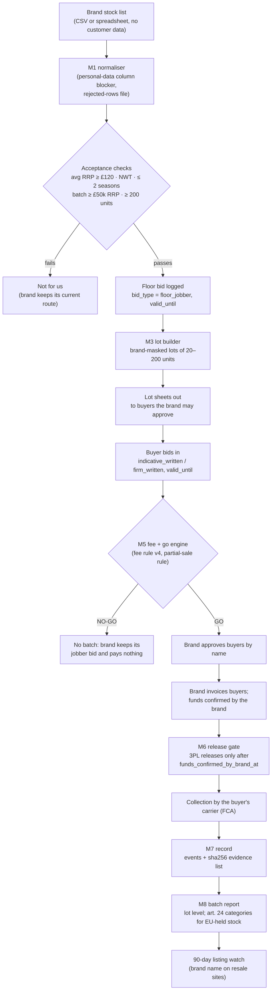
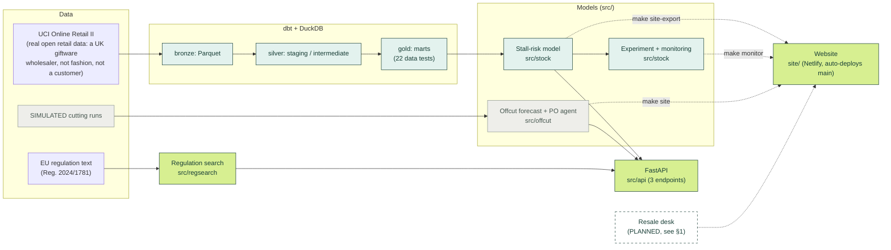

# Architecture

Architecture (updated Tue 24 Nov 2026). Two things live in this repo: (1) the resale desk, PLANNED (designed, not built; run in a Google Sheet until the 26 Feb 2027 decision), and (2) earlier portfolio and skills work (Parts 1–17), which is proof I can build, not the product. Built with AI-assisted tooling, reviewed and tested by me.

Until the 26 Feb 2027 decision we build nothing new: we use spreadsheets (the Google Sheet CRM, lot sheets, bid form and calculator), and scripts only when a real stock list or a real bid run needs them. No hosted app, no logins, no Stock Health index.

Thread Futures is a B2B resale service for fashion brands: we act as their sales team for stock they can't sell themselves (checking, finding buyers such as off-price retailers/resale platforms, contracts), and give them the money from each sale plus a record of which approved buyer took each lot, and what they declare happened next. The brand keeps ownership of the stock until it is sold, invoices each buyer and is paid directly. We invoice only our fee.

This file is the one technical map of the whole product. It replaces the Part 18 design in [6_planned.md](6_planned.md#part-18-batch-report-prototype) and lines up with the Operating Playbook's platform blueprint (M1–M10), the Recovery Calculator v0.3 and the Brand Pack calculator.

## Contents

- [1. The resale desk (PLANNED): technical map](#1-the-resale-desk-planned-technical-map)
  - [1.1 Process map](#11-process-map)
  - [1.2 Module status](#12-module-status)
  - [1.3 Data model](#13-data-model)
  - [1.4 Fee and go algorithm (fee rule v4)](#14-fee-and-go-algorithm-fee-rule-v4)
  - [1.5 Worked checks](#15-worked-checks)
  - [1.6 Security and data handling](#16-security-and-data-handling)
  - [1.7 Ops stack until GO (Dec 2026 – Feb 2027)](#17-ops-stack-until-go-dec-2026--feb-2027)
  - [1.8 Known gaps in the desk design](#18-known-gaps-in-the-desk-design)
- [2. Earlier portfolio and skills work (Parts 1–17)](#2-earlier-portfolio-and-skills-work-parts-117)

---

## 1. The resale desk (PLANNED): technical map

**Status: PLANNED (designed, not built).** Every step below runs by hand in a Google Sheet, the existing lot sheets, the bid form, the Recovery Calculator and email until the 26 Feb 2027 GO / PIVOT / STOP decision. The module names (M1–M10) are the Operating Playbook's; the code they describe is not written. Every number in this section is ILLUSTRATIVE [E] unless it says otherwise.

### 1.1 Process map



In plain words: the brand sends a list; we check it fits; we write down the brand's current written offer from its jobber (the floor); we split the stock into small unbranded lots; trade buyers bid on them; the calculator says GO only if the buyers beat the floor by enough to cover our minimum fee; the brand approves each buyer by name and invoices them; the brand's own warehouse (3PL) releases the goods only when the brand confirms it has been paid; and we keep a record of each handover and send the brand a report.

Note on module numbers: the Playbook's M5 is "contracts / e-signature". On this map the fee and go check sits at the M5 step because it is what has to happen before anything is signed; it is a calculation (today: the Recovery Calculator), not a separate module.

### 1.2 Module status

All effort figures are the Playbook's estimates [E]: pilot toolkit 2–3 weeks; V1 (single tenant) 6–9 weeks; V2 (multi-tenant, payments) 14–22 weeks plus an engineer. Part 18's "about 4 days" is superseded.

| Module | Purpose | Status now | Stand-in until GO | V1 target (after GO) |
|---|---|---|---|---|
| M1 Intake and lot-file normaliser | Turn each brand's export into one canonical stock list; block personal-data columns; rejected-rows file | PLANNED; spreadsheet stand-in | Google Sheet import tab; a script only when a real stock list arrives | Upload page; per-brand mapping profiles |
| M2 Grading / condition capture | Three counts: system, physical, graded | PLANNED; spreadsheet stand-in | 3PL sheet on a TF template (carton check and one photo per style) | Magic-link 3PL form; reconciliation view |
| M3 Curated-lot builder | Split a list into 20–200-unit lots by category and size curve; brand-masked lot sheets | PLANNED; spreadsheet stand-in | Existing lot sheet (xlsx/pdf) filled by hand | Lot builder UI; estimator = rules on realised bids |
| M4 Buyer network and bids | Vetting, sealed bids, brand approves each award | PLANNED; spreadsheet stand-in | Google Sheet `bids` tab; bid form by email | Magic-link lot pages; sealed bids with server timestamp |
| M5 Contracts / e-signature | Framework agreement, buyer terms | PLANNED; not before the visa grant and incorporation | Templates only (qLegal review pending) | Dropbox Sign (or similar); signed-PDF hash in the record |
| M6 Payments and release gate | Buyer pays the brand; no release until the brand confirms funds | PLANNED; manual email | Brand's written "funds received" email, logged in `settlements` | Payment-status field plus a release-gate check |
| M7 Evidence record | Append-only events with evidence-file hashes | PLANNED; spreadsheet stand-in | `events` rows plus a `shasum -a 256` file list | Postgres append-only, hash chain, head hash emailed to the brand |
| M8 Batch report | Net £ against the floor, routes, evidence completeness, art. 24 rows for EU-held stock | PLANNED; spreadsheet stand-in | Hand-built report from the Sheet | Generated from the database |
| M9 3PL integration | Instructions and counts to and from the brand's 3PL | PLANNED; manual email | Email plus CSV templates | CSV in and out with schema checks |
| M10 Platform plumbing | Auth, roles, tenancy, audit log, backups | Not before GO | Google Workspace with 2-step verification; one Drive folder per brand | One tenant; magic links |

The fee and go check (§1.4) runs today in the existing Recovery Calculator and the `fees` tab: it needs no new build.

### 1.3 Data model

The money logic needs relational state, not just an event log. These are Google Sheet tabs now, with the same column names as a later Postgres schema. **Until GO only three tabs are used in the Google Sheet: `bids`, `lots`, `fees`; the rest wait for a real list.**

| Tab / table | Key columns | Why |
|---|---|---|
| `brands` | brand_id, legal_name, masked_code, tier (recognised / independent), rrp_band, outlet (Y/N), sponsor_contact_id, nda_date, framework_agreement_version | Anonymity: the brand's name is stored only here |
| `batches` | batch_id, brand_id, list_received_at, units, rrp_total, acceptance_checks (avg RRP / £50k / ≥ 200 / NWT / ≤ 2 seasons), status | The £50k and acceptance rules live here |
| `lines` | batch_id, sku, gtin, size, colour, category, qty_system, qty_physical, qty_graded, grade, rrp, cn_code, weight_kg | The three-count reconciliation (M2) |
| `lots` | lot_id, batch_id, units, rrp_value, floor_share (pro-rata by RRP), lot_sheet_version, lot_sheet_hash, min_value_ok | Buyers bid per lot |
| `buyers` | buyer_id, legal_name, registry_no, country, vat, ubo_checked, sanctions_screened_at, terms_version_signed, excluded_territories | Checks on each buyer plus signed destination terms |
| `bids` | bid_id, lot_id **or** batch_id, scope (whole_batch / lot / remainder), bidder_id, **bid_type** (`floor_jobber` / `floor_platform` / `ask_observed` / `indicative_written` / `firm_written`), amount, currency, **vat_basis**, **valid_until**, received_at, **evidence_sha256** | The floor is a bid of type `floor_jobber`; every bid records when it expires |
| `awards` | lot_id, bid_id, brand_approved_by, approved_at, approval_evidence_hash | The brand approves every buyer by name |
| `settlements` | lot_id, invoice_no (the brand's), amount_invoiced, **funds_confirmed_by_brand_at**, released_at, collected_at, transport_doc_hash | Release gate: `funds_confirmed_by_brand_at` must come before `released_at` |
| `passthrough` | batch_id, supplier, amount, approved_at | Warehouse costs, arranged with and paid by the brand, at cost |
| `fees` | batch_id, buyer_money, passthrough, floor_effective, uplift, fee, verdict, computed_at, **rule_version** | The fee is a computed row, frozen when the batch closes |
| `events` | event_id, **prev_hash**, **hash**, batch_id, lot_id, event_type, timestamp, recorded_by, lines (gtin × qty), units, weight_kg, cn_code, counterparty, route, reason_code, derogation_ground, destination_country, declared_channel, evidence_refs, evidence_strength | Append-only; each row's hash covers the previous row's hash |

`ask_observed` rows are stock-house asking prices (price evidence, never a floor). Replies on SIMULATED lot sheets are logged as `indicative_written` ("written indicative prices"); only a real lot can produce a `firm_written` bid. The `scope` column was added on 24 Nov 2026 for the partial-sale rule (a `remainder` bid is the jobber's written price for lots left over).

### 1.4 Fee and go algorithm (fee rule v4)

The rule, in brand-facing words: "Our fee comes only out of the extra above your jobber's written bid: the larger of £1,500 or 30% of the extra. If the extra doesn't cover it, the batch doesn't go ahead, and you pay nothing." The minimum applies from the first batch. There is no cap.

```
floor_effective = max(written floor bids still valid on decision date)    # D5 may add platform bids
uplift          = buyer_money − passthrough − floor_effective
fee_if_go       = max(1500, 0.30 × max(0, uplift))                        # +£1/unit >1,500 units: not CANON (D6)
brand_test      = buyer_money ≥ floor_effective + passthrough + 1500      # same as uplift ≥ 1500
desk_check      = fee_if_go / est_hours ≥ 30          # est_hours = 20 + 0.03 × units (repeat); first batch 60 h
partial_ok      = every sold lot's bid ≥ its RRP-pro-rata share of the floor,
                  OR a written remainder bid exists for unsold lots          # first 3 batches; D4
go              = acceptance_ok AND brand_test AND desk_check AND partial_ok AND floor_valid
fee_charged     = fee_if_go if go else 0
brand_net       = buyer_money − passthrough − fee_charged if go else floor_effective
```

Remainder re-bid variant (iii), for later batches once a jobber relationship exists:

```
uplift = buyer_money(sold lots) + remainder_bid(unsold lots) − passthrough − floor_effective
```

How to read it:

- **floor_valid:** GO only while the floor bid's `valid_until` is still in the future on the decision date. If it lapses, get it re-confirmed in writing before deciding.
- **desk_check is internal.** It is Thread Futures' own viability test, not a brand-facing verdict; the brand sees only the brand test. The £30/h kill applies to the median modelled repeat batch. The first batch is planned at 60 h, so a minimum-fee first batch sits below it (£1,500 ÷ 60 h = £25/h); that is expected and recorded, not a reason to stop a first batch.
- **partial_ok** is the interim rule, RECOMMENDED, PENDING CAT (D4): for the first three batches, go ahead only if every lot has a buyer bid above its share of the jobber bid (pro-rata by RRP), or the jobber confirms in writing what it will pay for any lots left over; after that, a written remainder re-bid. It keeps the promise "On the bids, you never end up below your written jobber bid."
- **Sequencing:** written bids come in before any 3PL work, so on a NO-GO no pass-through has been spent and the brand's net is exactly its jobber bid. If a carton check ever happened before the bids, that cost would be sunk and would have to be subtracted on a NO-GO too.
- **Display:** on a NO-GO the fee, net-gain and "30% share" rows should show "—", never £1,500 (tech review §3.4; the calculator fix belongs to the packs package).

### 1.5 Worked checks

All ILLUSTRATIVE [E]. Each row reproduces the shared worked examples; run the pseudocode above and you get the same pounds.

| Case | Batch | Floor (jobber) | Buyer money | Pass-through | Uplift | Fee | Brand net | vs jobber |
|---|---|---|---|---|---|---|---|---|
| Worst case at the go bar (shown first) | 300 × £180 = £54,000 | 5% = £2,700 | 10% = £5,400 | £450 | £2,250 | £1,500 (67% of the uplift, 28% of buyer money) | £3,450 | +£750 |
| Headline | 300 × £180 = £54,000 | 5% = £2,700 | 13% = £7,020 | £450 | £3,870 | £1,500 (30% = £1,161, so the minimum applies) | £5,070 | +£2,370 |
| NO-GO | 300 × £180 = £54,000 | 8% = £4,320 | 10% = £5,400 | £450 | £630 | £0 (batch doesn't go ahead) | £4,320 (jobber) | £0 |
| Recognised, ask-vs-bid low | 300 × £180 = £54,000 | 12% = £6,480 | 13% = £7,020 | £450 | £90 | £0, NO-GO | £6,480 | £0 |
| Recognised, mid | 300 × £180 = £54,000 | 12% = £6,480 | 20% = £10,800 | £450 | £3,870 | £1,500 | £8,850 | +£2,370 |
| Recognised, high | 300 × £180 = £54,000 | 12% = £6,480 | 25% = £13,500 | £450 | £6,570 | £1,971 | £11,079 | +£4,599 |
| Second example (Brand Pack and calculator default) | 600 × £150 = £90,000 | 8% = £7,200 | 15% = £13,500 | £900 | £5,400 | £1,620 | £10,980 | +£3,780 |

Desk check on these rows (repeat-batch hours): 300 units → 20 + 9 = 29 h, so £1,500 ÷ 29 h ≈ £52/h; 600 units → 38 h, so £1,620 ÷ 38 h ≈ £43/h. Both pass £30/h. As a first batch (60 h) the headline earns £25/h, as expected.

Take-rate line: "On a £54k batch at 10–13% bids our fee is about 21–28% of buyer money, more than B-Stock (~10%) or Liquidity Services (~11%), because you pay only on the money above your own written offer, and nothing if we don't beat it."

**Partial-sale check (SIMULATED).** The headline batch (300 units, £54,000 RRP, jobber bid £2,700 for the whole batch, pass-through £450) is split into 6 lots of 50 units, each £9,000 RRP, so each lot's pro-rata floor share is £2,700 × 9,000 ÷ 54,000 = £450. Buyers bid on 4 lots, at 13% of RRP each.

| Lot | RRP | Floor share | Best buyer bid | Above its floor share? |
|---|---|---|---|---|
| 1 | £9,000 | £450 | £1,170 | yes |
| 2 | £9,000 | £450 | £1,170 | yes |
| 3 | £9,000 | £450 | £1,170 | yes |
| 4 | £9,000 | £450 | £1,170 | yes |
| 5 | £9,000 | £450 | none | **no** |
| 6 | £9,000 | £450 | none | **no** |
| Total | £54,000 | £2,700 | £4,680 | |

- **Without the partial-sale rule** the calculator would compute uplift = £4,680 − £450 − £2,700 = £1,530, which clears the £1,500 bar, so it would say GO with a £1,500 fee. The brand would get £2,730 in cash and still hold 100 unsold units, and the jobber will not honour its whole-batch £2,700 bid on the two lots nobody wanted. The brand could end up below its jobber bid, and the fee would be charged on an uplift that isn't real.
- **Rule (ii), all-or-nothing on pro-rata floors:** lots 5 and 6 have no bid above £450, so `partial_ok` is false: **NO-GO**. The brand keeps its £2,700 jobber bid (if still valid) and pays nothing.
- **With a written remainder bid:** if the jobber confirms in writing that it will pay, say, £500 for lots 5 and 6 [ILLUSTRATIVE], `partial_ok` is true and the remainder counts towards the brand test: uplift = £4,680 + £500 − £450 − £2,700 = £2,030 ≥ £1,500, so GO; fee = max(£1,500, 30% × £2,030 = £609) = £1,500; brand net = £4,680 + £500 − £450 − £1,500 = £3,230, which is +£530 against the jobber bid.

### 1.6 Security and data handling

From the Brand Pack security section:

- **No system access.** One CSV or spreadsheet of stock the brand has already set aside; no logins, live sales feeds or integrations.
- **NDA before any file** (signed with the company, after incorporation). We sign the brand's data processing agreement if any personal data could be involved.
- **Brand names are stored only in `brands`.** Lot sheets, bids and buyer-facing files carry the masked code.
- **Google Workspace with 2-step verification** (passkey or security key), a password manager, sharing with named people only, never "anyone with the link", one folder per brand.
- **Retention:** brand files deleted within 30 days of a batch closing unless the brand asks otherwise; lot-level evidence kept 5 years only if the brand wants it.
- **AI tools:** no identifiable interview notes or brand files in AI tools; AI is off by default on brand data.
- **Cyber Essentials:** planned before the first large-brand pilot.
- **Money:** buyers pay the brand directly. Thread Futures has no client account and never holds buyers' money, for payment-services reasons. Escrow (for example Transpact) for new buyers or lots over £5k: post-grant, post-incorporation.

### 1.7 Ops stack until GO (Dec 2026 – Feb 2027)

Allowed now (research only until the visa grant; no signing, invoicing or real-lot bid runs before it):

- Google Sheet CRM plus the `bids`, `lots` and `fees` tabs (§1.3).
- Lot sheets (xlsx and pdf) and the bid form.
- The Recovery Calculator (fee rule v4).
- Email.
- A sha256 file list for evidence received: `shasum -a 256 <file>` on each file, pasted into the `events` or `bids` row.

Post-grant and post-incorporation only: e-signature (for example Dropbox Sign), escrow (for example Transpact), Google Forms for sealed bids.

**Not before GO:** a hosted app, logins, the Stock Health pipeline, the hash-chained ledger (V1), any API.

Companies House limit: many small companies file abridged or filleted accounts without a profit and loss account. Stock levels are usually there, but sales and cost of sales often aren't, so "stock turn" can't be computed for much of the target list.

### 1.8 Known gaps in the desk design

- No real stock list yet, so M1 and M3 have nothing real to run on.
- Partial-sale method pending (decision D4); the interim rule above is a recommendation.
- Floor definition pending (decision D5): what counts as the floor when a brand has no written jobber bid. Brand-facing: "we agree a written floor with you before we start". Internal recommendation: one written reference bid from a named jobber who is never in that batch's buyer pool, logged before any buyer bid is opened.
- IP / insolvency-lot flow pending (decision D8): proposed fee MAX(£2,500, 12% of realisations), still to be decided; Thread Futures would act as agent of the office-holders, never principal, and buyers pay the estate.
- Legal templates (framework agreement, buyer terms, NDA) pending the qLegal review.
- Honest limit of the record: a hash proves nothing changed after it was recorded, not that the entry was true.

---

## 2. Earlier portfolio and skills work (Parts 1–17)

Everything below is proof I can build, not the product. Parts 1–10 are built; Parts 11–17 are PLANNED skills work, not the product, and none is being built before GO. Part 18 (the old batch report design) is superseded by §1.




Dotted arrows into `site/` are manual export steps. `site/` is the live website (Netlify, auto-deploys `main`), so only run them on purpose and check `make site-diff` before committing. Website copy edits for 24 Nov are on branch review/panel-24nov and go live only when merged.

### 2.1 Status of each part

| Part | Where | Status | What that means |
|---|---|---|---|
| Website | `site/` | **Live** | Static HTML, published by Netlify when `main` changes. No build step. |
| Regulation search | `src/regsearch/` | **Prototype** (internal research aid) | Finds the article of EU law that answers a question. ESPR articles only; 22-passage test set, hit@3 21/22 (a random ranking would get about 14%). Delegated Reg. (EU) 2026/296 and Implementing Reg. (EU) 2026/2 are adopted and not yet in the corpus; adding them waits until after GO. Rebuilds its index on each call, which is fine at this size. |
| API, CI and tests | `src/api/`, `tests/`, `.github/workflows/` | **Live** (maintenance only; the API is parked until after GO) | Demo FastAPI with offcut, stall-risk and regulation-search endpoints; CI runs pytest, builds the Docker image and calls the API. |
| dbt pipeline | `dbt/` | **Maybe later** | Bronze → silver → gold on real open retail data, 22 data tests. Not run in CI. Could be reused for brands' stock files after pilots. |
| Stall-risk model, experiment, monitoring | `src/stock/` | **Maybe later** | ROC AUC 0.8118 vs 0.5994 for a simple rule; top-20% precision 32% vs a 10.6% base rate. Real UCI Online Retail II data (a UK giftware wholesaler: not fashion, not a customer). A possible input to prevention ("make less"), a later stage. |
| Offcut forecast and purchase-order agent | `src/offcut/` | **Parked** | Earlier exploratory work for a previous idea (garment factories), not the product. SIMULATED data (MAPE 8.8% vs 20.25% for the baseline). Kept as proof of build. |
| Resale desk | [§1 above](#1-the-resale-desk-planned-technical-map) (Part 18 in [`6_planned.md`](6_planned.md#part-18-batch-report-prototype) is superseded) | **PLANNED** (designed, not built) | The product's technical map, data model and fee algorithm. Runs in a Google Sheet until the 26 Feb 2027 decision. |

### 2.2 Files that write into `site/`

| Command | Writes | Part of |
|---|---|---|
| `make monitor` | `site/reports/monitoring.html` | `make stock` |
| `make site` | `site/model.js` (offcut model) | `make all`, `make site-export` |
| `make site-export` | `site/model.js`, `site/data/stall_model.js`, `site/data/stock.js` | run on purpose only |

Website copy edits for 24 Nov are on branch review/panel-24nov and go live only when merged. `make claims-lint` checks the site, README and docs for retired claims (see `scripts/claims_lint.py`).

### 2.3 Known gaps (portfolio code)

- Tests: 23 tests; CI runs them; locally they need `pip install -r requirements.txt` in a virtualenv (for example `python3 -m venv .venv`).
- Locally, only the offcut tests run without the full environment (`fastapi` and `duckdb` are needed for the rest); CI has the full set.
- Several tests check saved artefacts in `models/` rather than re-running the code that made them.
- No tests yet for feature building, the experiment, training, monitoring, the site exports, ingest, the agent or generated regulation answers.

### 2.4 Documentation

The docs are grouped by theme. Each themed doc holds, for every part, a header block (discipline, methodology, tools, status), the short part note and the full step-by-step guide: the question it answers, the pipeline step by step with real code from this repo, every concept from scratch, the real results, what went wrong, honest limits, how to run it, and a glossary.

| Doc | Parts |
|---|---|
| [1_data_engineering.md](1_data_engineering.md) | 02 Analytics engineering, 03 Merchandising analytics |
| [2_ml_models.md](2_ml_models.md) | 01 Offcut forecasting, 04 Stall-risk model |
| [3_experiments_monitoring.md](3_experiments_monitoring.md) | 05 Experimentation and causal analysis, 06 Model monitoring |
| [4_ai_tools.md](4_ai_tools.md) | 07 Regulation search, 08 Purchase-order agent |
| [5_platform.md](5_platform.md) | 09 API service, 10 CI and Docker build |
| [6_planned.md](6_planned.md) | 11 to 17 (skills plans, not built); Part 18 superseded by §1 |

Parts 1 to 10 are built and public at https://github.com/catliugit/ThreadFutures: they are earlier portfolio and skills work, proof I can build, not the product. Parts 11 to 17 are skills plans, not the product, and none is being built before the 26 Feb 2027 decision. Part 18's old batch report design (built around donation offers and recycler statements for the earlier returns-and-damaged model) is superseded by the resale desk map in §1. The offcut forecast (Part 1) and the purchase-order agent (Part 8) are earlier exploratory work for a previous idea (garment factories), not the product.

Numbers come from the repo's models/*.json files; re-checked against them and dbt/target/run_results.json on 21 Nov 2026; labels re-checked on 24 Nov 2026. Earlier check on 17 Nov 2026 (parts 7 to 10 against models/*.json, tests/ and the CI log of 17 Nov 2026: 23 tests passed).

### 2.5 Discipline and methodology by part

Status follows the table above: **Live** (in use, maintenance only), **Prototype** (works, small scope, internal aid), **Maybe later** (could be reused after pilots), **Parked** (earlier exploratory work for a previous idea, garment factories, not the product), **Planned** (skills plans, not built, not before GO), **Superseded** (replaced by §1).

| Part | Discipline (primary / secondary) | Methodology | Tools | Status | Data label | Doc |
|---|---|---|---|---|---|---|
| 01 Offcut forecasting | Machine Learning / Data Science | Simulated cutting runs (skyline-packed markers plus losses) → gradient-boosted quantile regression (P10/P50/P90) vs marker-only and 15% baselines; trees exported to JSON for the browser. | Python, scikit-learn, pandas, NumPy, Matplotlib, JavaScript | Parked | SIMULATED cutting runs (not factory data) | [2_ml_models.md](2_ml_models.md#part-01-offcut-forecasting) |
| 02 Analytics engineering (dbt + DuckDB) | Data Engineering / Data Analytics | Ingest to Parquet, then dbt on DuckDB: staging → SKU-week intermediate → star-schema marts, with generic, macro and reconciliation tests and a MetricFlow semantic layer. | dbt Core, DuckDB, SQL, Jinja, Parquet, MetricFlow, Python | Maybe later | Real open retail data | [1_data_engineering.md](1_data_engineering.md#part-02-analytics-engineering-dbt--duckdb) |
| 03 Merchandising analytics | Data Analytics / Data Engineering | SQL mart: dense weekly calendar, 8-week rolling velocity, ABC by cumulative revenue, XYZ by coefficient of variation, selling / slowing / stopped status. | SQL, dbt, Jinja, DuckDB | Maybe later | Real open retail data | [1_data_engineering.md](1_data_engineering.md#part-03-merchandising-analytics) |
| 04 Stall-risk model | Machine Learning / Data Science | Ten early-life features from DuckDB → gradient-boosting classifier with a time-based split, scored against a "sales halved" rule; tracked and registered in MLflow. | scikit-learn, MLflow, DuckDB, pandas, joblib, skops | Maybe later | Real open retail data (UCI Online Retail II, a UK giftware wholesaler: not fashion, not a customer) | [2_ml_models.md](2_ml_models.md#part-04-stall-risk-model) |
| 05 Experimentation and causal analysis | Data Science / Data Analytics | Stacked difference-in-differences (OLS, stack fixed effects, SKU-clustered errors, matched cohort controls, placebo test); pilot power analysis, Welch's t-test and bootstrap CI. | statsmodels, SciPy, DuckDB, pandas, NumPy | Maybe later | Real data (markdowns) + simulated pilot | [3_experiments_monitoring.md](3_experiments_monitoring.md#part-05-experimentation-and-causal-analysis) |
| 06 Model monitoring | Machine Learning / Data Science | Per-quarter AUC, PR AUC and calibration; feature drift by PSI and KS test against alert thresholds; JSON plus static HTML report. | SciPy, scikit-learn, pandas, joblib, HTML | Maybe later | Real open retail data | [3_experiments_monitoring.md](3_experiments_monitoring.md#part-06-model-monitoring) |
| 07 Regulation search | AI Engineering / Data Science | Hand-written BM25 vs TF-IDF + cosine over chunked EU law, evaluated on 22 questions over a 22-passage test set (hit@k, MRR; hit@3 21/22, random ≈ 14%); optional LLM answer with citation check. ESPR articles only. | Python, scikit-learn, NumPy, LLM API (optional) | Prototype | Retrieval prototype over real EU law text | [4_ai_tools.md](4_ai_tools.md#part-07-regulation-search) |
| 08 Purchase-order agent | AI Engineering / Machine Learning | LLM with one tool wrapping deterministic forecast, grading and recycler matching; assumptions flagged, bad inputs returned as tool errors. | Anthropic Python SDK (tool use), Python, pytest | Parked | Prototype (calls the simulated-data forecast; fictional recycler profiles) | [4_ai_tools.md](4_ai_tools.md#part-08-purchase-order-agent) |
| 09 API service | AI Engineering / Machine Learning | FastAPI with a health check and three versioned endpoints; Pydantic validation (422), cached model loading, TestClient tests. | FastAPI, Pydantic, uvicorn, joblib, pytest | Live | Prototype | [5_platform.md](5_platform.md#part-09-api-service) |
| 10 CI and Docker build | DevOps / Platform engineering / Machine Learning (MLOps) | GitHub Actions: pytest job, then a Docker build-and-run smoke test; slim, non-root image with HEALTHCHECK. | GitHub Actions, Docker, pytest, Make | Live | Infrastructure (built 9 Nov 2026) | [5_platform.md](5_platform.md#part-10-ci-and-docker-build) |
| 11 Stock health dashboard | Data Analytics / Data Engineering | Planned: BI star schema on the dbt marts with DAX measures that match the MetricFlow definitions. | Power BI, Looker Studio, DAX | Planned | Planned | [6_planned.md](6_planned.md#part-11-stock-health-dashboard) |
| 12 Customer analytics | Data Science / Data Analytics | Planned: SQL acquisition cohorts and retention, RFM with k-means, simple LTV (optionally BG/NBD). | SQL, dbt, Python, scikit-learn | Planned | Planned | [6_planned.md](6_planned.md#part-12-customer-analytics) |
| 13 Cloud warehouse | Data Engineering / Data Analytics | Planned: same dbt project on a BigQuery or Snowflake target; row counts compared with DuckDB. | BigQuery, Snowflake, dbt | Planned | Planned | [6_planned.md](6_planned.md#part-13-cloud-warehouse) |
| 14 Spark at scale | Data Engineering / Machine Learning | Planned: stall-risk feature table rebuilt in PySpark with window functions; Delta tables checked against DuckDB. | Databricks, PySpark, Delta Lake | Planned | Planned | [6_planned.md](6_planned.md#part-14-spark-at-scale) |
| 15 Seasonality fix | Machine Learning / Data Science | Planned: seasonal features plus Platt or isotonic calibration; monitoring re-run to measure the fix. | scikit-learn, pandas, SciPy | Planned | Planned | [6_planned.md](6_planned.md#part-15-seasonality-fix) |
| 16 Markdown pricing (Bayesian) | Data Science / Machine Learning | Planned: hierarchical Bayesian elasticity model with partial pooling by category (MCMC). | PyMC, ArviZ, pandas | Planned | Planned | [6_planned.md](6_planned.md#part-16-markdown-pricing-bayesian) |
| 17 Azure deploy | AI Engineering / Data Engineering | Planned: CI-built image pushed to a registry and deployed to Azure Container Apps. | Azure Container Apps, Azure Container Registry, Docker | Planned | Planned | [6_planned.md](6_planned.md#part-17-azure-deploy) |
| 18 Batch report prototype | (superseded) | Superseded on 24 Nov 2026 by the resale desk map, data model and fee algorithm in §1. | — | Superseded | — | [§1](#1-the-resale-desk-planned-technical-map) |

### 2.6 Concept index

Concept, then the part that explains it best (other parts that use it in brackets). Numbers are part numbers; find each part's doc in the table above. "11_to_17 (part 11)" means the step-by-step section of that planned part in [6_planned.md](6_planned.md). Desk concepts (floor, uplift, pass-through, go bar, valid-until, release gate, hash chain) are explained in §1 here and in the learning page T15.

#### Data and analytics engineering
| Concept | File |
|---|---|
| Medallion layout (bronze, silver, gold) | 02 (01) |
| Data contracts | 01 (02) |
| dbt models, materialisation, `ref()`, DAG | 02 |
| dbt sources and `var()` | 02 (planned 13) |
| dbt generic and singular tests, custom test macros | 02 (03) |
| Reconciliation test | 02 |
| Semantic layer, MetricFlow, entities, measures, metrics, time spine | 02 (planned 11) |
| Star schema, dimension and fact tables, grain | 02 |
| DuckDB | 02 |
| Parquet | 02 |
| Left-censoring | 02 (04) |
| Window functions, rolling averages, CTEs, Jinja | 03 |
| Dense vs sparse time series (zero weeks) | 03 (04) |
| `FILTER (WHERE ...)` aggregates | 04 |

#### Merchandising
| Concept | File |
|---|---|
| ABC classification, Pareto | 03 |
| XYZ classification | 03 |
| Coefficient of variation | 03 |
| Sales velocity, velocity ratio | 03 |
| Sell-through and weeks of cover (and why not used) | 03 |
| Markdown depth, list price as mode of small orders | 02, 03 |
| Return rate | 03 (02) |
| Launch cohorts | 03 (05) |

#### Machine learning
| Concept | File |
|---|---|
| Simulation from first principles | 01 |
| Quantile regression, pinball loss | 01 |
| P10 / P50 / P90, interval coverage, quantile crossing | 01 |
| Gradient boosting (regression and classification), trees, hyperparameters | 01, 04 |
| One-hot encoding | 01 |
| Train/test split vs time-based split | 01, 04 |
| Data leakage, censoring leakage | 01, 04 |
| Baselines | 01, 04 |
| MAE, MAPE, within ±15%, bias | 01 |
| Base rate | 04 |
| ROC AUC vs PR AUC | 04 (06) |
| Precision at top k | 04 |
| Calibration, Brier score | 04, 06 (planned 15) |
| Feature importance | 04 |
| MLflow tracking and model registry, joblib, skops | 04 |
| Float32 thresholds, export parity tests | 01 (04, 09) |

#### Experimentation and causal inference
| Concept | File |
|---|---|
| Correlation vs causation, observational vs randomised | 05 |
| Difference-in-differences, stacked DiD | 05 |
| Parallel trends, placebo test, pre-trend, upper bound | 05 |
| Matched controls, fixed effects | 05 |
| Clustered standard errors | 05 |
| Log outcomes as percentage effects | 05 |
| Confidence intervals, p-values | 05 |
| Power analysis, effect size (Cohen's d), alpha, power | 05 |
| Welch t-test | 05 |
| Bootstrap confidence interval | 05 |

#### Monitoring
| Concept | File |
|---|---|
| Data drift vs concept drift | 06 |
| PSI (Population Stability Index) | 06 |
| KS test | 06 |
| Ranking vs calibration by period | 06 |
| Alert thresholds, alert fatigue | 06 |
| Static HTML reports | 06 |

#### Search and language models
| Concept | File |
|---|---|
| Tokenisation, stop words, stemming | 07 |
| TF-IDF, cosine similarity | 07 |
| BM25 (k1, b) | 07 |
| hit@k, MRR, evaluation sets | 07 |
| Retrieval-augmented generation (RAG), hallucination | 07 |
| Citation checking | 07 |
| Embeddings, hybrid search (not yet used) | 07 |
| Tool use / function calling, agents, agent loop | 08 |
| System prompts, structured extraction, flagged assumptions | 08 |
| Tool errors as feedback | 08 |
| Hard constraints then weighted scoring (recycler matching) | 08 |
| Environment variables, `.env` and secrets | 08 (10) |

#### Software and deployment
| Concept | File |
|---|---|
| REST, HTTP methods, status codes (422) | 09 |
| FastAPI, Pydantic validation, `Literal`, `Field` | 09 |
| Health checks, versioned endpoints | 09 (10) |
| pytest, TestClient, unit vs integration tests | 09 |
| CI, GitHub Actions (workflow, job, step, runner, `needs`) | 10 |
| Pinned dependencies | 10 |
| Docker image vs container, Dockerfile layers, non-root user, HEALTHCHECK | 10 |
| Smoke tests | 10 |
| Container registry, CD | 10 (planned 17) |

#### Planned (not built)
| Concept | File |
|---|---|
| DAX, filter context, BI data models | 11_to_17 (part 11) |
| Cohort retention, churn, RFM, k-means, LTV, BG/NBD | 11_to_17 (part 12) |
| Cloud warehouses, dbt targets and adapters, SQL dialects | 11_to_17 (part 13) |
| Spark, lazy evaluation, shuffles, Delta Lake | 11_to_17 (part 14) |
| Seasonal features, Platt scaling, isotonic regression, reliability diagrams | 11_to_17 (part 15) |
| Elasticity, Bayesian inference, partial pooling, MCMC, credible intervals | 11_to_17 (part 16) |
| Azure Container Apps, ingress, scale to zero, revisions | 11_to_17 (part 17) |
